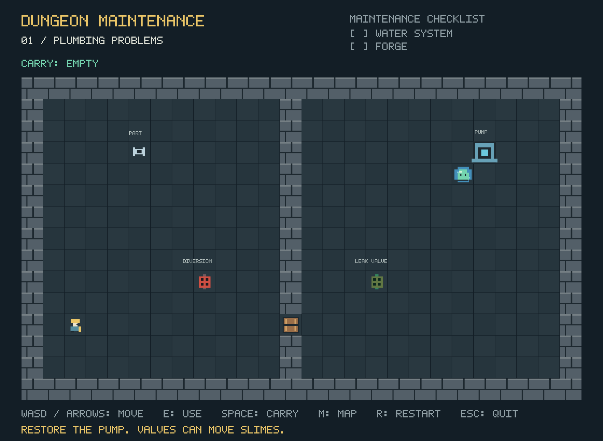
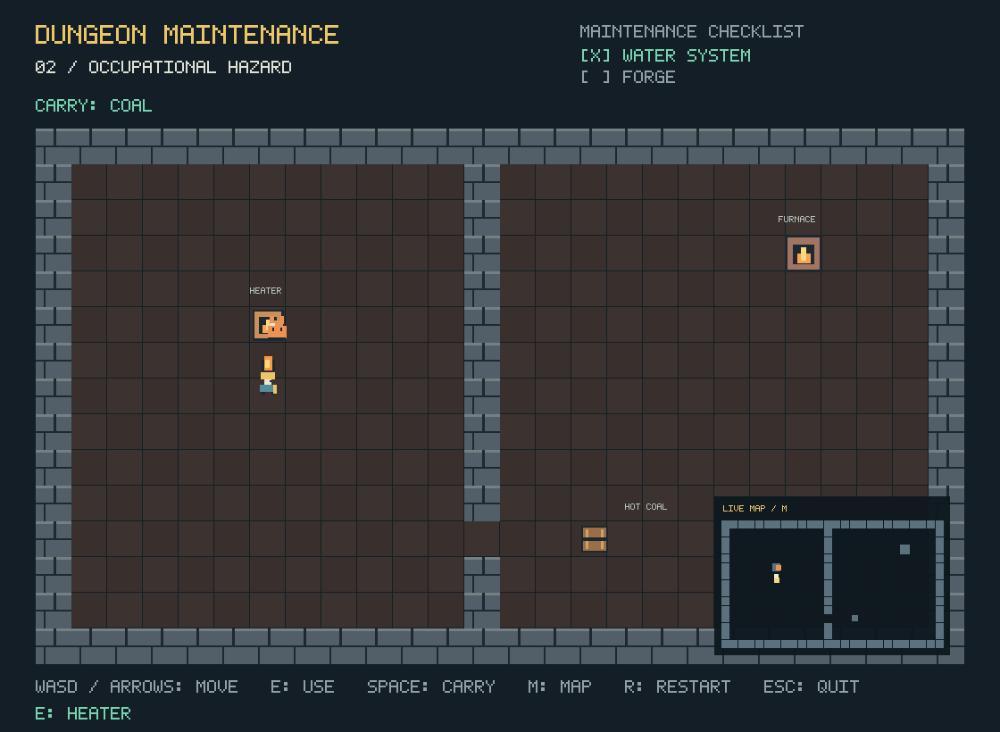

# Dungeon Maintenance

Dungeon Maintenance is a top-down puzzle demo built with C++17 and SDL2 for the component architecture assignment. Carry parts, push crates, and redirect creatures to repair the dungeon's pump and forge. Both repairs are needed to pass inspection.



## Build and run

On Windows, install GCC, SDL2, and TinyXML2 in the same MSYS2 environment. For MINGW64, run this in its MSYS2 terminal:

```bash
pacman -S --needed mingw-w64-x86_64-gcc mingw-w64-x86_64-SDL2 mingw-w64-x86_64-tinyxml2 mingw-w64-x86_64-pkgconf
```

Open this folder in VS Code or PowerShell, then run:

```powershell
powershell.exe -NoProfile -ExecutionPolicy Bypass -File .\build.ps1
.\build\dungeon-maintenance.exe
```

The script uses `g++.exe` from PATH or `C:\msys64\mingw64\bin`. It copies the DLLs and room data into `build`, so the executable also runs from File Explorer. Keep those files together, and close the game before rebuilding.

In VS Code, Ctrl+Shift+B builds. The Run Dungeon Maintenance and Test Dungeon Maintenance tasks launch the game and automated checks.

For Linux or an MSYS2 terminal with the dependencies installed:

```bash
bash build.sh
./build/dungeon-maintenance
```

## Controls

| Input | Action |
| --- | --- |
| WASD / arrows | Move |
| E | Use a valve, heater, or repair station |
| Space | Pick up or drop an item |
| Walk into a crate | Push it |
| M | Toggle the minimap |
| R | Restart the room, or the game after winning |
| Escape | Quit |

## Components

Each `GameObject` stores a `vector<unique_ptr<Component>>` and provides `add<T>()`, `get<T>()`, `update()`, and `draw()`. Objects share this class without subclasses. The abstract `Component` class defines `update()`, `draw()`, and a `parent()` reference.

| Component | Purpose |
| --- | --- |
| `SpriteComponent` | Draws the object's texture at its position and angle |
| `BodyComponent` | Stores position, velocity, and angle; handles movement and rectangle collisions |
| `ControllerComponent` | Reads `Input` for movement, carrying, and interaction |
| `SlimeBehaviorComponent` | Finds a route to the nearest reachable active puddle |
| `HeatSeekingComponent` | Follows carried coal and settles at a lit heater |
| `ValveComponent` / `PuddleComponent` | Create, remove, and identify water sources |
| `CarryableComponent` / `PushableComponent` | Mark items the player can carry or push |
| `RepairComponent` / `HeatSourceComponent` | Track repairs and active heaters |

TinyXML2 reads the rooms in `data`. `ComponentFactory` uses a map of constructor functions to build their objects and components. Valves create and delete puddle objects during play, and the minimap tracks current object positions. Graphics and the bitmap font are generated in code.



## Tests

```powershell
.\build\dungeon-maintenance.exe --self-test
```

The 35 automated checks cover components, XML validation, input, collisions, carrying, creature behavior, both repairs, and restart. The full game has also been played through on Windows. Build output stays in the ignored `build` folder.
